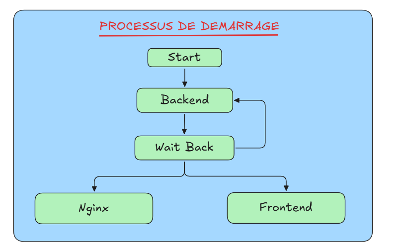
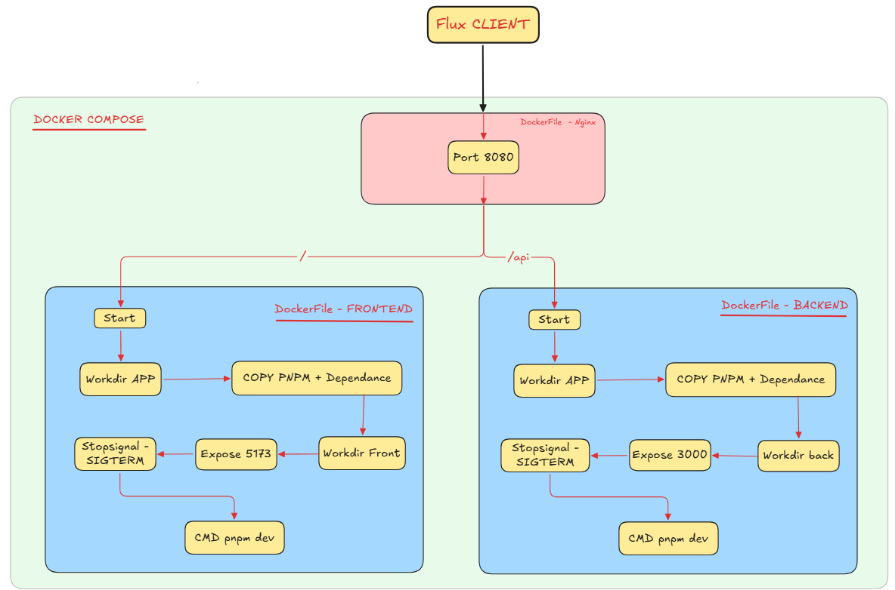
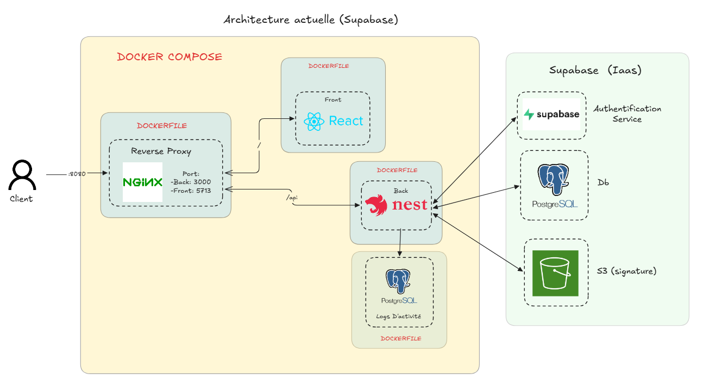

# Compte Rendu

## Choix

## Processus de Démarrage Docker
Voici le processus de démarrage des dockers.On démarre le backend en premier car ils peuvent contenir des proccessus longtemps à son démarrage comme création de user test,hook,etc.



## Docker Compose
Très simple, expose les ports par défaults des techno. Avec une installation de PNPM redonnandete.



## Architecture Stack
Mon parti pris d'être actuellement dépendant de Supabase a été fait pour accélérer le temps de développement, en utilisant ses services d'auth,le S3 pour les signatures ainsi que la DB.



### Dépendance installés + Manipulation sur l’OS

On crée un workspace pour installer pnpm pour optimiser l'espace disque puis copier les différences fichiers
```bash
WORKDIR /app

RUN corepack enable

COPY pnpm-lock.yaml pnpm-workspace.yaml package.json ./
COPY apps/frontend/package.json apps/frontend/

RUN pnpm install --frozen-lockfile

COPY apps/application apps/application      #ex: COPY apps/frontend apps/frontend
```